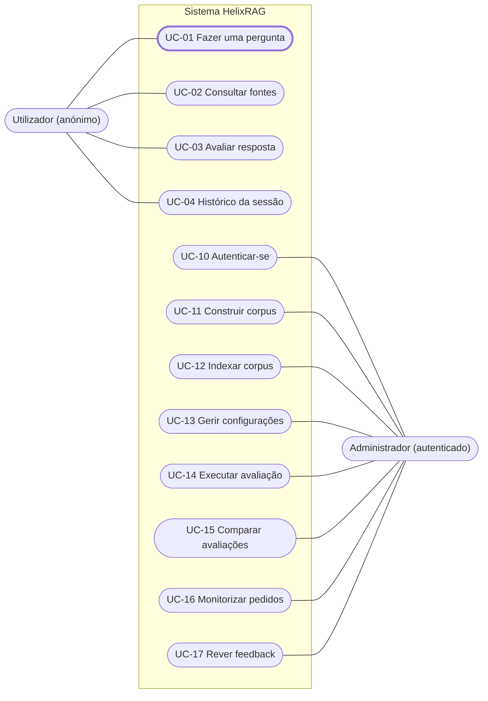
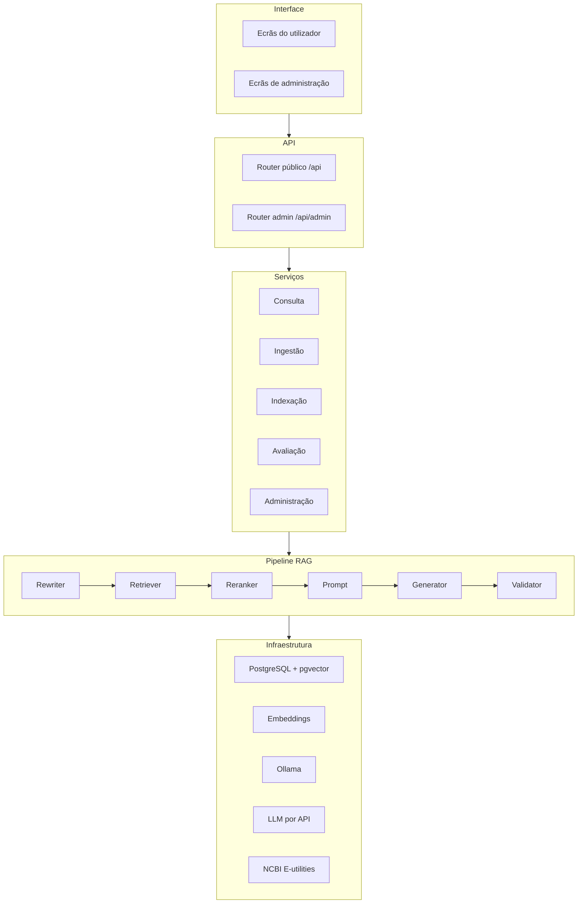

# HelixRAG — Documentação do Projeto

Versão 0.1 · 26 de outubro de 2026

## 1. Descrição geral

O HelixRAG é um sistema RAG que responde a perguntas sobre genómica, bioquímica e bioinformática a partir de resumos do PubMed, citando os PMIDs usados, e cujas decisões de arquitetura são medidas com o benchmark BioASQ. É o projeto final do CET TPSI (IEFP Braga).

### 1.1 Problema

- A literatura biomédica é vasta: encontrar os artigos que respondem a uma pergunta concreta exige saber pesquisar e ler muito.
- Um LLM sozinho responde com conhecimento congelado no treino, pode inventar resultados ou referências e não indica as fontes.

### 1.2 Objetivos

| ID | Objetivo | Como se verifica |
| --- | --- | --- |
| O1 | Responder com base exclusiva nos resumos recuperados, citando os PMIDs | Validade das citações medida em cada resposta |
| O2 | Construir um pipeline modular, com cada etapa substituível por configuração | Trocar retriever, reranker ou gerador sem alterar código |
| O3 | Medir objetivamente cada decisão de arquitetura | Experiências E1–E7 com métricas sobre o BioASQ |
| O4 | Disponibilizar o sistema por API e interface web | Utilizador pergunta e vê fontes; administrador gere o sistema |

### 1.3 Dentro do âmbito

- Corpus de resumos do PubMed: documentos de ouro do BioASQ + distratores do mesmo tema.
- Pesquisa densa, lexical e híbrida; reranking; geração com citações e validação.
- Avaliação da recuperação e da geração; comparação de configurações.
- Área de administração: corpus, indexação, configurações, avaliação, monitorização.

### 1.4 Fora do âmbito (*Won't* nesta versão)

- Texto integral dos artigos (PubMed Central).
- Contas de utilizador, histórico pessoal guardado no servidor.
- Conversa com memória entre perguntas.
- Upload de documentos pelo utilizador.
- Atualização automática e contínua do corpus.
- Qualquer forma de aconselhamento médico.

### 1.5 Pressupostos e restrições

- **Prazo:** cerca de 13 semanas, um único programador.
- **Hardware:** um Mac com Apple Silicon corre o modelo local, os embeddings e a base de dados.
- **Dados:** acesso aos dados de treino do BioASQ (registo gratuito) e a uma chave de API da NCBI.
- **Licenças:** os resumos e os dados do BioASQ não são redistribuídos no repositório.
- **Requisitos da unidade:** ainda não conhecidos; este documento é revisto quando forem publicados.

## 2. Atores e papéis

O sistema tem dois papéis humanos: o Utilizador, anónimo, que faz perguntas, e o Administrador, autenticado, que gere o corpus, as configurações e a avaliação. Três sistemas externos fornecem dados e geração.

### 2.1 Utilizador

- **Quem é:** estudante, investigador ou profissional de biociências que procura o que a literatura diz sobre uma questão concreta.
- **Objetivo:** obter uma resposta curta, fundamentada e verificável, com acesso direto aos artigos.
- **Acesso:** anónimo, sem conta. As perguntas ficam registadas sem dados pessoais, para monitorização e avaliação (ver secção 11).

### 2.2 Administrador

- **Quem é:** o autor do projeto ou quem opere o sistema.
- **Objetivo:** manter o corpus, escolher a configuração do pipeline servida aos utilizadores e medir a qualidade do sistema.
- **Acesso:** autenticado com nome de utilizador e palavra-passe. A conta é criada por linha de comando, não pela interface.

### 2.3 Sistemas externos

| Sistema | Papel | Ligação |
| --- | --- | --- |
| NCBI E-utilities | Fonte dos resumos, títulos, revistas, anos e termos MeSH | API HTTP, chamada só na ingestão |
| Ollama | Gerador local, por omissão | API HTTP na própria máquina |
| Fornecedor de LLM por API | Gerador alternativo, para comparação | API HTTP externa, opcional |
| BioASQ | Perguntas e documentos de ouro para avaliação | Ficheiro descarregado manualmente após registo |

### 2.4 Permissões por papel

| Ação | Utilizador | Administrador |
| --- | --- | --- |
| Fazer perguntas e ver fontes | Sim | Sim |
| Aplicar filtros (ano, MeSH) | Sim | Sim |
| Avaliar respostas | Sim | Sim |
| Construir e indexar o corpus | Não | Sim |
| Gerir configurações do pipeline | Não | Sim |
| Executar e comparar avaliações | Não | Sim |
| Consultar pedidos, traços e feedback | Não | Sim |

### 2.5 Decisão: utilizador anónimo vs registado

- **Alternativa considerada:** contas de utilizador, com histórico pessoal no servidor.
- **Porquê anónimo:** o objetivo do projeto é a arquitetura RAG, não a gestão de contas. Contas trariam dados pessoais (com obrigações de RGPD), registo, recuperação de palavra-passe e mais superfície de ataque, sem melhorar nenhuma métrica do sistema.
- **Consequência:** o histórico de perguntas existe só na sessão do browser.

## 3. Requisitos funcionais

O sistema tem 29 requisitos funcionais, dos quais 16 são *Must*. Estão agrupados por área, e cada um liga a um ou mais casos de uso (matriz na secção 14).

### 3.1 Consulta (Utilizador)

| ID | Requisito | Prioridade |
| --- | --- | --- |
| RF-01 | Submeter uma pergunta em linguagem natural, em inglês ou português, até 500 caracteres | Must |
| RF-02 | Receber uma resposta gerada apenas a partir dos resumos recuperados, com cada afirmação citada por PMID | Must |
| RF-03 | Ver as fontes usadas: título, revista, ano, PMID, ligação ao PubMed e o resumo | Must |
| RF-04 | Ser informado quando os resumos recuperados não contêm a resposta, em vez de receber uma resposta inventada | Must |
| RF-05 | Ver assinaladas as citações a PMIDs que não foram recuperados | Must |
| RF-06 | Restringir a pesquisa a um intervalo de anos de publicação | Should |
| RF-07 | Restringir a pesquisa a termos MeSH | Could |
| RF-08 | Avaliar uma resposta como útil ou não útil, com comentário opcional | Should |
| RF-09 | Rever as perguntas feitas na sessão atual | Could |
| RF-10 | Ver os avisos legais: não é aconselhamento médico, aviso de copyright da NCBI | Must |
| RF-11 | Ver a resposta a aparecer progressivamente (streaming) | Could |
| RF-12 | Receber os resultados da pesquisa mesmo quando o gerador está indisponível | Should |

### 3.2 Corpus e indexação (Administrador)

| ID | Requisito | Prioridade |
| --- | --- | --- |
| RF-20 | Autenticar-se e terminar sessão | Must |
| RF-21 | Importar listas de PMIDs, marcadas como ouro ou distrator | Must |
| RF-22 | Descarregar os registos do PubMed, respeitando os limites da NCBI e retomando após falhas | Must |
| RF-23 | Converter o XML do PubMed em registos normalizados (PMID, título, resumo com secções, revista, ano, MeSH) | Must |
| RF-24 | Indexar o corpus: gerar embeddings com um modelo escolhido e o índice full-text | Must |
| RF-25 | Ver o estado do corpus: número de artigos, falhas, data, modelos de embeddings indexados | Should |
| RF-26 | Acompanhar o progresso das tarefas longas (download, indexação) | Should |

### 3.3 Configuração do pipeline (Administrador)

| ID | Requisito | Prioridade |
| --- | --- | --- |
| RF-30 | Criar e editar configurações: retriever, reranker, reescrita da pergunta, top-k, modelo de embeddings, gerador | Must |
| RF-31 | Escolher a configuração ativa servida aos utilizadores | Must |

### 3.4 Avaliação (Administrador)

| ID | Requisito | Prioridade |
| --- | --- | --- |
| RF-40 | Importar as perguntas do BioASQ e selecionar o subconjunto segundo um critério documentado | Must |
| RF-41 | Avaliar a recuperação de uma configuração: Recall@10, MRR, nDCG@10, latência | Must |
| RF-42 | Avaliar a geração numa amostra: correção, validade das citações, recusas | Should |
| RF-43 | Comparar as métricas de várias execuções lado a lado | Should |
| RF-44 | Exportar resultados em CSV ou JSON | Could |

### 3.5 Monitorização (Administrador)

| ID | Requisito | Prioridade |
| --- | --- | --- |
| RF-50 | Registar o traço de cada pedido: etapas, latências, candidatos recuperados, PMIDs citados | Must |
| RF-51 | Consultar a lista de pedidos e o traço de cada um | Should |
| RF-52 | Rever o feedback dos utilizadores, ligado ao pedido respetivo | Should |

## 4. Requisitos não funcionais

Os requisitos não funcionais fixam como o sistema se comporta: desempenho, reprodutibilidade, segurança, privacidade, aspetos legais e manutenção. Os valores de desempenho são metas iniciais, a confirmar com medições no hardware real.

| ID | Categoria | Requisito | Prioridade |
| --- | --- | --- | --- |
| RNF-01 | Desempenho | A recuperação (pesquisa + reranking, sem geração) responde em menos de 1 s no percentil 95, com o corpus completo | Must |
| RNF-02 | Desempenho | Com o modelo local, a resposta completa chega em menos de 30 s no percentil 95; com streaming, o primeiro texto em menos de 5 s | Should |
| RNF-03 | Qualidade | A configuração final supera a pesquisa densa simples (base de comparação) no Recall@10 e no MRR | Must |
| RNF-04 | Reprodutibilidade | O corpus é definido por listas de PMIDs versionadas; cada avaliação regista configuração, commit do código, modelos usados e data | Must |
| RNF-05 | Portabilidade | O sistema arranca com Docker Compose e um ambiente virtual Python, em macOS (Apple Silicon) e Linux | Must |
| RNF-06 | Segurança | Palavras-passe guardadas com hash forte (argon2 ou bcrypt); sessão em cookie httpOnly; todos os endpoints de administração exigem autenticação | Must |
| RNF-07 | Segurança | Segredos (chave NCBI, chaves de API) ficam em `.env`, fora do Git; existe um `.env.example` sem valores | Must |
| RNF-08 | Segurança | Todas as entradas são validadas (tamanho, tipo, intervalos); o endpoint público de perguntas tem limite de pedidos por minuto | Must |
| RNF-09 | Privacidade | O utilizador não é identificado: não se guardam IPs nem dados pessoais; os registos de perguntas têm prazo de retenção definido | Must |
| RNF-10 | Legal | Resumos e dados do BioASQ não são redistribuídos; a interface mostra o aviso da NCBI; o relatório cita o BioASQ | Must |
| RNF-11 | Robustez | Se o gerador falhar, o sistema devolve os resultados da pesquisa com um aviso (degradação graciosa); chamadas à NCBI repetem com espera crescente | Should |
| RNF-12 | Manutenibilidade | Cada etapa do pipeline é uma interface com implementações intermutáveis; código com type hints e verificado com um linter | Must |
| RNF-13 | Testabilidade | Os módulos centrais (parser, fusão, métricas, validador de citações) têm testes unitários | Must |
| RNF-14 | Observabilidade | Logs estruturados em JSON, com um identificador por pedido que liga log, traço e feedback | Must |
| RNF-15 | Usabilidade | Interface utilizável em ecrã de portátil e de telemóvel; citações clicáveis; mensagens de erro compreensíveis | Should |
| RNF-16 | Segurança do LLM | O texto dos resumos é tratado como dados, delimitado no prompt, para reduzir o risco de instruções escondidas no conteúdo | Should |

## 5. Casos de uso

Há 12 casos de uso: 4 do Utilizador e 8 do Administrador. O central é o UC-01 (fazer uma pergunta), que atravessa o pipeline inteiro; os do Administrador preparam, configuram e medem esse pipeline.



O UC-01, em destaque, é o único que atravessa o pipeline inteiro; todos os casos do Administrador existem para o alimentar, configurar ou medir.

### 5.1 Lista

| ID | Caso de uso | Ator | Prioridade |
| --- | --- | --- | --- |
| UC-01 | Fazer uma pergunta | Utilizador | Must |
| UC-02 | Consultar as fontes de uma resposta | Utilizador | Must |
| UC-03 | Avaliar uma resposta | Utilizador | Should |
| UC-04 | Rever o histórico da sessão | Utilizador | Could |
| UC-10 | Autenticar-se | Administrador | Must |
| UC-11 | Construir o corpus | Administrador | Must |
| UC-12 | Indexar o corpus | Administrador | Must |
| UC-13 | Gerir configurações do pipeline | Administrador | Must |
| UC-14 | Executar uma avaliação | Administrador | Must |
| UC-15 | Comparar avaliações | Administrador | Should |
| UC-16 | Monitorizar pedidos | Administrador | Should |
| UC-17 | Rever feedback | Administrador | Should |

### 5.2 UC-01 — Fazer uma pergunta

- **Ator:** Utilizador. **Requisitos:** RF-01 a RF-07, RF-10 a RF-12, RF-50.
- **Pré-condições:** corpus indexado; existe uma configuração ativa.
- **Fluxo principal:**
  1. O utilizador escreve a pergunta e, opcionalmente, define filtros (anos, MeSH).
  2. O sistema valida a entrada e cria um identificador de pedido.
  3. O sistema recupera candidatos (densa, lexical ou híbrida, conforme a configuração) e aplica os filtros.
  4. O reranker, se ativo, reordena os candidatos e ficam os k melhores.
  5. O sistema monta o prompt com os resumos e envia-o ao gerador.
  6. O validador confirma que cada PMID citado foi recuperado.
  7. O sistema mostra a resposta com citações clicáveis e a lista de fontes.
  8. O sistema regista o traço do pedido.
- **Fluxos alternativos:**
  - 2a. Pergunta vazia ou com mais de 500 caracteres: o sistema mostra o erro e não processa.
  - 2b. Limite de pedidos excedido: o sistema pede para tentar mais tarde.
  - 3a. Nenhum resultado (por exemplo, filtros demasiado restritivos): o sistema informa e sugere alargar os filtros.
  - 5a. Os resumos não contêm a resposta: o sistema diz que não a encontrou na literatura indexada (RF-04).
  - 5b. Gerador indisponível: o sistema mostra só as fontes recuperadas, com aviso (RF-12).
  - 6a. Citação a um PMID não recuperado: a citação aparece assinalada (RF-05).
- **Pós-condições:** a resposta e o traço ficam registados com o identificador do pedido.

### 5.3 UC-02 — Consultar as fontes de uma resposta

- **Ator:** Utilizador. **Requisitos:** RF-03.
- **Pré-condições:** UC-01 concluído com resposta.
- **Fluxo principal:** o utilizador clica numa citação ou na lista de fontes; o sistema mostra título, revista, ano, PMID e resumo, com a ligação ao artigo no PubMed.
- **Fluxo alternativo:** o PMID já não existe no corpus (reindexação entretanto): o sistema mostra só o PMID e a ligação.

### 5.4 UC-03 — Avaliar uma resposta

- **Ator:** Utilizador. **Requisitos:** RF-08.
- **Pré-condições:** UC-01 concluído.
- **Fluxo principal:** o utilizador marca a resposta como útil ou não útil e pode escrever um comentário; o sistema guarda a avaliação ligada ao pedido.
- **Fluxo alternativo:** avaliação repetida para o mesmo pedido: a última substitui a anterior.

### 5.5 UC-04 — Rever o histórico da sessão

- **Ator:** Utilizador. **Requisitos:** RF-09.
- **Fluxo principal:** o utilizador abre o histórico; o browser mostra as perguntas desta sessão e permite reabrir a resposta de cada uma.
- **Nota:** o histórico vive só no browser; fechar a sessão apaga-o.

### 5.6 UC-10 — Autenticar-se

- **Ator:** Administrador. **Requisitos:** RF-20.
- **Pré-condições:** a conta foi criada por linha de comando.
- **Fluxo principal:** o administrador introduz nome e palavra-passe; o sistema verifica o hash e abre uma sessão.
- **Fluxos alternativos:** credenciais erradas: mensagem genérica, sem indicar qual campo falhou; várias falhas seguidas: espera crescente antes de nova tentativa.
- **Pós-condições:** sessão ativa; termina por logout ou por expiração.

### 5.7 UC-11 — Construir o corpus

- **Ator:** Administrador; NCBI E-utilities. **Requisitos:** RF-21, RF-22, RF-23, RF-25, RF-26.
- **Pré-condições:** sessão ativa; chave NCBI configurada.
- **Fluxo principal:**
  1. O administrador importa as listas de PMIDs (ouro e distratores).
  2. O sistema cria uma tarefa de download e devolve o seu identificador.
  3. O sistema descarrega os registos em lotes, dentro do limite de pedidos por segundo.
  4. O sistema converte cada registo XML num artigo normalizado e guarda-o.
  5. O administrador acompanha o progresso e vê o resumo final (descarregados, falhados).
- **Fluxos alternativos:**
  - 1a. Já existe uma tarefa a correr: o sistema recusa a nova.
  - 3a. Erro de rede ou limite excedido: o sistema repete com espera crescente.
  - 3b. A tarefa é interrompida: ao relançar, retoma a partir dos PMIDs em falta.
  - 4a. Registo sem resumo: é guardado e marcado; não entra na indexação.

### 5.8 UC-12 — Indexar o corpus

- **Ator:** Administrador. **Requisitos:** RF-24, RF-26.
- **Pré-condições:** corpus construído.
- **Fluxo principal:** o administrador escolhe o modelo de embeddings e a unidade de indexação (resumo inteiro ou por secção); o sistema cria os chunks, calcula os embeddings, atualiza o índice full-text e constrói o índice vetorial; no fim, regista o modelo como disponível.
- **Fluxo alternativo:** reindexação com um modelo já indexado: o sistema pede confirmação e substitui os vetores desse modelo.

### 5.9 UC-13 — Gerir configurações do pipeline

- **Ator:** Administrador. **Requisitos:** RF-30, RF-31.
- **Fluxo principal:** o administrador cria ou edita uma configuração (retriever, reranker, reescrita, top-k, modelo de embeddings, gerador) e pode ativá-la para os utilizadores.
- **Fluxos alternativos:** a configuração usa um modelo de embeddings não indexado: o sistema recusa a ativação; uma configuração com avaliações associadas não é editada, é duplicada, para não alterar resultados já registados.

### 5.10 UC-14 — Executar uma avaliação

- **Ator:** Administrador. **Requisitos:** RF-40, RF-41, RF-42.
- **Pré-condições:** perguntas BioASQ importadas e selecionadas; corpus indexado com o modelo da configuração.
- **Fluxo principal:** o administrador escolhe a configuração e o tipo (recuperação, ou recuperação + geração numa amostra); o sistema corre todas as perguntas, calcula as métricas por pergunta e agregadas, e guarda a execução com configuração, commit e data.
- **Fluxo alternativo:** falha a meio: a execução fica marcada como falhada, com as perguntas já processadas guardadas.

### 5.11 UC-15 — Comparar avaliações

- **Ator:** Administrador. **Requisitos:** RF-43, RF-44.
- **Fluxo principal:** o administrador escolhe duas ou mais execuções; o sistema mostra as métricas lado a lado e as perguntas em que os resultados divergem; o administrador pode exportar.

### 5.12 UC-16 — Monitorizar pedidos

- **Ator:** Administrador. **Requisitos:** RF-50, RF-51.
- **Fluxo principal:** o administrador vê a lista de pedidos (data, configuração, latência total, recusa, citações inválidas) e abre um pedido para ver o traço: candidatos de cada etapa, posições, tempos e resposta.

### 5.13 UC-17 — Rever feedback

- **Ator:** Administrador. **Requisitos:** RF-52.
- **Fluxo principal:** o administrador vê as avaliações dos utilizadores, filtra as negativas e abre o traço do pedido correspondente para perceber em que etapa a resposta falhou.

## 6. Arquitetura

O sistema é um monólito modular em Python, organizado em cinco camadas: interface, API, serviços, pipeline e infraestrutura. O pipeline RAG é composto por interfaces com implementações intermutáveis, escolhidas por configuração, e é isso que permite medir cada decisão sem reescrever código.



Cada camada só chama a de baixo; o pipeline, ao centro, não conhece a API, e cada etapa pode ser trocada por configuração.

### 6.1 Camadas

| Camada | Responsabilidade | Componentes |
| --- | --- | --- |
| Interface | Ecrãs do utilizador e do administrador | Páginas HTML (Jinja2) servidas pelo FastAPI |
| API | Receber pedidos HTTP, validar, autenticar, devolver JSON | Routers públicos e de administração (FastAPI + Pydantic) |
| Serviços | Casos de uso: perguntar, ingerir, indexar, avaliar, administrar | `QueryService`, `IngestionService`, `IndexingService`, `EvaluationService`, `AdminService` |
| Pipeline | As etapas do RAG, atrás de interfaces | `Retriever`, `Reranker`, `QueryRewriter`, `PromptBuilder`, `Generator`, `CitationValidator`, `Pipeline` |
| Infraestrutura | Acesso a dados e serviços externos | Repositórios PostgreSQL, cliente NCBI, cliente Ollama, cliente de API de LLM, modelo de embeddings |

As dependências apontam só para baixo: a API conhece os serviços, os serviços conhecem o pipeline e os repositórios, e o pipeline não conhece a API.

### 6.2 Interfaces do pipeline

| Interface | Entrada → saída | Implementações |
| --- | --- | --- |
| `QueryRewriter` | pergunta → pergunta reformulada | Nenhuma (identidade), reescrita por LLM |
| `Retriever` | pergunta + filtros → lista ordenada de chunks com pontuação | Densa (pgvector), lexical (full-text), híbrida (RRF das duas) |
| `Reranker` | pergunta + candidatos → candidatos reordenados | Nenhum (identidade), cross-encoder |
| `PromptBuilder` | pergunta + top-k → prompt | Uma, com resumos delimitados e numerados por PMID |
| `Generator` | prompt → texto com citações | Ollama, fornecedor por API |
| `CitationValidator` | resposta + PMIDs recuperados → citações válidas e inválidas | Uma |

O `Pipeline` recebe uma configuração, instancia as implementações pedidas (uma pequena *factory*) e corre as etapas por ordem, medindo a latência de cada uma.

### 6.3 Fluxo de ingestão (offline)

1. Importar as listas de PMIDs (ouro e distratores).
2. Descarregar os registos do PubMed por `efetch`, em lotes, dentro do limite de pedidos.
3. Converter o XML em artigos normalizados e guardá-los.
4. Criar os chunks (resumo inteiro ou por secção).
5. Calcular os embeddings com o modelo escolhido e guardá-los.
6. Atualizar o índice full-text e construir o índice vetorial (HNSW).

### 6.4 Sequência de uma pergunta (online)

1. **Browser → API:** `POST /api/ask` com a pergunta e os filtros.
2. **API → QueryService:** valida, aplica o limite de pedidos, cria o identificador.
3. **QueryService → Pipeline:** corre a configuração ativa.
4. **Pipeline → Retriever → PostgreSQL:** pesquisa densa e lexical, fusão por RRF, filtros.
5. **Pipeline → Reranker:** reordena os cerca de 50 candidatos e fica com os k melhores.
6. **Pipeline → PromptBuilder → Generator → Ollama:** gera a resposta.
7. **Pipeline → CitationValidator:** compara os PMIDs citados com os recuperados.
8. **QueryService → PostgreSQL:** guarda o pedido e o traço.
9. **API → Browser:** devolve a resposta, as citações, as fontes e o identificador.

Tarefas longas (download, indexação, avaliação) não bloqueiam pedidos: a API devolve `202 Accepted` com o identificador da tarefa, que corre em segundo plano, e o administrador consulta o progresso.

### 6.5 Decisões de arquitetura

| ID | Decisão | Alternativa rejeitada | Razão |
| --- | --- | --- | --- |
| ADR-01 | Monólito modular | Microserviços | Um programador, 13 semanas; a modularidade vem das interfaces, não da rede |
| ADR-02 | Pipeline próprio com interfaces | LangChain / LlamaIndex | Os frameworks escondem as decisões que o projeto quer medir e defender |
| ADR-03 | PostgreSQL + pgvector | Chroma, FAISS | Texto, metadados, vetores e full-text numa base só; filtros em SQL |
| ADR-04 | Pesquisa híbrida com RRF | Só densa | Nomes de genes e siglas exigem correspondência exata |
| ADR-05 | Reranking em duas fases | Cross-encoder sobre todo o corpus | O cross-encoder é lento; só se aplica a cerca de 50 candidatos |
| ADR-06 | Gerador local por omissão, API como alternativa | Só API | Custo zero e privacidade; a comparação é uma experiência |
| ADR-07 | Tarefas longas em segundo plano | Pedido HTTP síncrono | Um download de milhares de registos excede qualquer timeout razoável |
| ADR-08 | Interface HTML no FastAPI | Streamlit, React | Separa API e interface sem acrescentar outra stack |

## 7. Modelo de dados

A base de dados PostgreSQL tem 13 tabelas (contando uma de embeddings por modelo) em quatro grupos: corpus, configuração e acesso, pedidos, e avaliação. A decisão menos óbvia é guardar os embeddings numa tabela por modelo, porque o pgvector exige uma dimensão fixa para indexar.

### 7.1 Corpus

| Tabela | Campos principais | Notas |
| --- | --- | --- |
| `article` | `pmid` (PK), `title`, `abstract`, `abstract_sections` (JSONB), `journal`, `year`, `mesh` (`text[]`), `origin` (gold / distractor), `fetched_at` | Um registo por artigo do PubMed |
| `chunk` | `id` (PK), `pmid` (FK), `unit` (full / section), `section_label`, `text`, `tsv` (tsvector) | A unidade de pesquisa; `tsv` alimenta a pesquisa lexical |
| `embedding_<modelo>` | `chunk_id` (PK, FK), `vector` (`vector(d)`) | Uma tabela por modelo de embeddings, com índice HNSW |
| `embedding_model` | `id` (PK), `name`, `dimension`, `table_name`, `indexed_at` | Registo dos modelos indexados |
| `job` | `id` (PK), `kind` (download / index / eval), `status`, `total`, `done`, `failed`, `started_at`, `finished_at`, `error` | Progresso das tarefas longas |

### 7.2 Configuração e acesso

| Tabela | Campos principais | Notas |
| --- | --- | --- |
| `pipeline_config` | `id` (PK), `name`, `params` (JSONB), `is_active`, `created_at` | Só uma ativa de cada vez; imutável depois de ter avaliações |
| `admin_user` | `id` (PK), `username` (único), `password_hash`, `created_at` | Criada por linha de comando |

### 7.3 Pedidos e monitorização

| Tabela | Campos principais | Notas |
| --- | --- | --- |
| `query_log` | `id` (UUID, PK), `created_at`, `question`, `filters` (JSONB), `config_id` (FK), `answer`, `refused`, `invalid_citations`, `total_ms` | Sem IP nem dados pessoais |
| `stage_trace` | `id` (PK), `query_id` (FK), `stage`, `duration_ms`, `details` (JSONB) | Um registo por etapa: candidatos, posições, pontuações |
| `feedback` | `id` (PK), `query_id` (FK, único), `rating` (up / down), `comment`, `created_at` | Uma avaliação por pedido; a última substitui |

### 7.4 Avaliação

| Tabela | Campos principais | Notas |
| --- | --- | --- |
| `eval_question` | `id` (PK, id BioASQ), `type`, `body`, `gold_pmids` (`text[]`), `ideal_answer`, `exact_answer` (JSONB), `selected` | Importada do ficheiro BioASQ |
| `eval_run` | `id` (PK), `config_id` (FK), `kind`, `git_commit`, `status`, `started_at`, `finished_at`, `metrics` (JSONB) | Métricas agregadas da execução |
| `eval_result` | `run_id` (FK), `question_id` (FK), `retrieved_pmids` (`text[]`), `recall_at_10`, `reciprocal_rank`, `ndcg_at_10`, `answer`, `judgement` | Resultado por pergunta, para encontrar onde as configurações divergem |

### 7.5 Relações

- Um `article` tem um ou mais `chunk`; cada `chunk` tem no máximo um vetor por modelo.
- Uma `pipeline_config` é usada por muitos `query_log` e muitos `eval_run`.
- Um `query_log` tem várias `stage_trace` e, no máximo, um `feedback`.
- Um `eval_run` tem um `eval_result` por `eval_question` selecionada.

### 7.6 Decisão: uma tabela de embeddings por modelo

- **Problema:** os modelos produzem vetores de dimensões diferentes, e um índice HNSW no pgvector só funciona sobre uma coluna com dimensão fixa.
- **Alternativas:** uma coluna por modelo na tabela `chunk` (a tabela cresce a cada modelo testado); uma coluna sem dimensão fixa (impede o índice).
- **Escolha:** uma tabela por modelo, registada em `embedding_model`. Comparar modelos (experiência E2) é só indexar mais uma tabela, e apagar um modelo é apagar a sua tabela.

## 8. API

A API REST tem 4 endpoints públicos e 18 de administração, todos em JSON. Os de administração exigem sessão autenticada; as tarefas longas respondem `202 Accepted` com o identificador da tarefa.

### 8.1 Endpoints públicos

| Método | Caminho | Descrição | UC |
| --- | --- | --- | --- |
| POST | `/api/ask` | Pergunta + filtros → resposta, citações (válidas e inválidas), fontes, `request_id` | UC-01 |
| GET | `/api/articles/{pmid}` | Detalhe de um artigo do corpus | UC-02 |
| POST | `/api/feedback` | `request_id`, avaliação (up / down), comentário | UC-03 |
| GET | `/api/health` | Estado da base de dados e do gerador | — |

Exemplo de resposta de `POST /api/ask`:

```json
{
  "request_id": "6f1c…",
  "answer": "Cystic fibrosis is caused by mutations in the CFTR gene [PMID:12345678].",
  "refused": false,
  "citations": {"valid": ["12345678"], "invalid": []},
  "sources": [{"pmid": "12345678", "title": "…", "journal": "…", "year": 2019}],
  "degraded": false
}
```

### 8.2 Endpoints de administração

| Método | Caminho | Descrição | UC |
| --- | --- | --- | --- |
| POST | `/api/admin/login` | Abre sessão | UC-10 |
| POST | `/api/admin/logout` | Termina sessão | UC-10 |
| POST | `/api/admin/corpus/pmids` | Importa uma lista de PMIDs (ouro ou distrator) | UC-11 |
| POST | `/api/admin/corpus/fetch` | Inicia o download (202 + `job_id`) | UC-11 |
| GET | `/api/admin/corpus/status` | Totais, falhas, modelos indexados | UC-11 |
| POST | `/api/admin/index` | Inicia a indexação com um modelo e uma unidade (202 + `job_id`) | UC-12 |
| GET | `/api/admin/jobs/{id}` | Progresso de uma tarefa | UC-11, UC-12, UC-14 |
| GET | `/api/admin/configs` | Lista as configurações | UC-13 |
| POST | `/api/admin/configs` | Cria uma configuração | UC-13 |
| PUT | `/api/admin/configs/{id}` | Edita (só sem avaliações associadas) | UC-13 |
| POST | `/api/admin/configs/{id}/activate` | Torna-a a configuração ativa | UC-13 |
| POST | `/api/admin/eval/questions` | Importa o ficheiro BioASQ e aplica a seleção | UC-14 |
| POST | `/api/admin/eval/runs` | Inicia uma avaliação (202 + `job_id`) | UC-14 |
| GET | `/api/admin/eval/runs` | Lista as execuções | UC-15 |
| GET | `/api/admin/eval/compare?ids=…` | Compara execuções; `format=csv` exporta | UC-15 |
| GET | `/api/admin/queries` | Lista os pedidos, com filtros | UC-16 |
| GET | `/api/admin/queries/{id}` | Pedido com o traço completo e o feedback | UC-16, UC-17 |
| GET | `/api/admin/feedback` | Lista o feedback, filtrável por avaliação | UC-17 |

### 8.3 Erros

| Código | Quando |
| --- | --- |
| 400 / 422 | Entrada inválida (pergunta vazia ou longa demais, parâmetros fora de intervalo) |
| 401 | Sem sessão num endpoint de administração |
| 404 | Recurso inexistente (PMID, configuração, execução) |
| 409 | Conflito: já há uma tarefa do mesmo tipo a correr; editar uma configuração com avaliações |
| 429 | Limite de pedidos excedido em `/api/ask` |
| 503 | Base de dados indisponível; se só o gerador falhar, `/api/ask` responde 200 com `degraded: true` |

Todas as respostas de erro têm o mesmo formato: `{"error": {"code": "…", "message": "…", "request_id": "…"}}`.

## 9. Interface do utilizador

A interface tem 3 ecrãs públicos e 7 de administração. O ecrã público mais importante é o da resposta: as citações e as fontes têm de estar à vista sem esforço, porque são elas que tornam a resposta verificável.

### 9.1 Ecrãs públicos

| Ecrã | O que mostra | UC |
| --- | --- | --- |
| Pergunta | Caixa de texto (máx. 500 caracteres), filtros opcionais (anos, MeSH), exemplos de perguntas, aviso de que não é aconselhamento médico, aviso da NCBI no rodapé | UC-01 |
| Resposta | Texto com citações clicáveis por PMID; citações inválidas assinaladas; painel lateral de fontes (título, revista, ano, ligação ao PubMed, resumo expansível); botões útil / não útil e comentário; aviso quando a resposta é recusada ou degradada | UC-01, UC-02, UC-03 |
| Histórico | Perguntas desta sessão, por ordem inversa, para reabrir | UC-04 |

### 9.2 Ecrãs de administração

| Ecrã | O que mostra | UC |
| --- | --- | --- |
| Login | Nome e palavra-passe | UC-10 |
| Painel | Estado do corpus, configuração ativa, tarefas em curso, latência média e taxa de recusa recentes | UC-16 |
| Corpus | Importação de listas de PMIDs, início do download, progresso, falhas; indexação por modelo e unidade | UC-11, UC-12 |
| Configurações | Lista, criação, edição e ativação de configurações | UC-13 |
| Avaliação | Importação BioASQ, início de execuções, lista de execuções, comparação lado a lado, exportação | UC-14, UC-15 |
| Pedidos | Lista filtrável de pedidos; detalhe com o traço por etapa (candidatos, posições, tempos) | UC-16 |
| Feedback | Avaliações dos utilizadores, com ligação ao pedido | UC-17 |

### 9.3 Princípios

- Fontes sempre visíveis ao lado da resposta, nunca escondidas atrás de um clique extra.
- Estado do sistema explícito: "a pesquisar", "a gerar", "resposta recusada", "gerador indisponível".
- Linguagem simples nos avisos e nos erros; os detalhes técnicos ficam no traço, para o administrador.

## 10. Avaliação

Cada decisão de arquitetura é medida contra perguntas do BioASQ escritas por especialistas, com a recuperação e a geração avaliadas em separado, para saber em que etapa o sistema falha.

### 10.1 Dados

- **Perguntas:** subconjunto dos dados de treino da Task B do BioASQ, nas áreas de genómica, bioquímica e bioinformática. O critério de seleção (por exemplo, termos MeSH dos documentos de ouro) é aplicado por script e documentado.
- **Documentos de ouro:** os PMIDs que o BioASQ indica para cada pergunta selecionada.
- **Distratores:** milhares de resumos do mesmo tema. Sem eles, qualquer pesquisa acertaria; distratores parecidos com os documentos certos tornam o teste realista.

### 10.2 Métricas de recuperação

| Métrica | O que mede |
| --- | --- |
| Recall@10 | Fração dos documentos de ouro entre os 10 primeiros resultados (o BioASQ também limita a 10) |
| MRR | Posição média do primeiro documento de ouro (1/posição) |
| nDCG@10 | Qualidade da ordenação, com mais peso nas primeiras posições |
| Latência p50 / p95 | Tempo de cada etapa e total |

### 10.3 Métricas de geração (amostra)

| Métrica | Como |
| --- | --- |
| Correção | Perguntas sim/não e factuais comparadas com a resposta exata; resumos avaliados à mão contra a resposta de referência |
| Validade das citações | Fração de PMIDs citados que estavam entre os recuperados |
| Fidelidade | Cada afirmação está apoiada nos resumos? (avaliação manual) |
| Recusa | Perguntas cuja resposta não está no corpus devem ser recusadas |

### 10.4 Experiências

| ID | Variável | Comparação | Prioridade |
| --- | --- | --- | --- |
| E1 | Unidade de indexação | Resumo inteiro vs por secção | Must |
| E2 | Embeddings | Multilingue geral vs biomédico | Must |
| E3 | Pesquisa | Densa vs lexical vs híbrida (RRF), com e sem reranker | Must |
| E4 | Índice vetorial | Exato vs HNSW (latência e recall) | Must |
| E5 | Filtros | Pré-filtragem vs pós-filtragem | Could |
| E6 | Língua | Perguntas em inglês vs as mesmas em português | Could |
| E7 | Gerador | Ollama vs API | Must |

A base de comparação é a pesquisa densa simples, sem reranker. Cada execução guarda configuração, commit e data, para poder ser repetida.

### 10.5 Limitações

- Os documentos de ouro do BioASQ não são exaustivos: um distrator relevante encontrado pelo sistema conta como erro, por isso as métricas subestimam a qualidade real.
- A avaliação manual da geração cobre só uma amostra e é feita pelo autor.

## 11. Segurança, privacidade e aspetos legais

O sistema não guarda dados pessoais, protege a área de administração com autenticação e não redistribui conteúdo de terceiros. Cada ameaça identificada tem uma medida concreta.

### 11.1 Ameaças e medidas

| Ameaça | Medida | Requisito |
| --- | --- | --- |
| Acesso indevido à administração | Login com hash argon2/bcrypt, cookie de sessão httpOnly e SameSite, expiração de sessão, espera crescente após falhas | RNF-06 |
| Fuga de segredos | Chaves em `.env` fora do Git; `.env.example` sem valores | RNF-07 |
| Abuso do endpoint público (custo, negação de serviço) | Limite de pedidos por minuto; tamanho máximo da pergunta | RNF-08 |
| Injeção de SQL | Consultas sempre parametrizadas, nunca texto concatenado | RNF-08 |
| XSS na interface | Templates com escape automático; o texto gerado é mostrado como texto, não como HTML | RNF-08 |
| Instruções escondidas no conteúdo (*prompt injection*) | Resumos delimitados no prompt e tratados como dados; validação das citações após a geração | RNF-16 |
| Respostas tomadas como conselho médico | Aviso visível em todas as respostas | RF-10 |

### 11.2 Privacidade

- O utilizador não tem conta e não é identificado; não se guardam IPs.
- Guarda-se o texto das perguntas, as respostas e o traço, para monitorização e avaliação. A interface informa que as perguntas são registadas.
- Os registos têm um prazo de retenção definido e são apagados depois dele.
- O limite de pedidos usa um identificador de sessão efémero, nunca guardado na base de dados.

### 11.3 Licenças e atribuição

- **PubMed / NCBI:** dados obtidos pelas E-utilities. Alguns resumos podem ter direitos de autor, por isso não vão para o repositório; a interface mostra o aviso legal e de copyright da NCBI.
- **BioASQ:** usado nos termos da licença de investigação, após registo; não é redistribuído; os artigos do BioASQ são citados no relatório.
- **Modelos:** a licença de cada modelo usado (embeddings, reranker, LLM) é verificada e registada no README.

## 12. Estratégia de testes

Os testes têm quatro níveis automáticos: unitários para a lógica pura, integração com a base de dados real, contrato da API e regressão de qualidade com o próprio benchmark, mais uma verificação manual. O gerador é substituído por um falso nos testes automáticos, para que sejam rápidos e determinísticos.

| Nível | O que cobre | Exemplos | Ferramenta |
| --- | --- | --- | --- |
| Unitário | Funções sem I/O | Parser XML com registos de exemplo (resumo estruturado, sem resumo, caracteres especiais); fusão RRF com listas conhecidas; Recall@10, MRR e nDCG com casos calculados à mão; validador de citações | pytest |
| Integração | Componentes com PostgreSQL real | Inserir artigos e chunks, pesquisa densa e lexical, filtros por ano, pipeline completo com gerador falso | pytest + PostgreSQL em Docker |
| API | Contrato dos endpoints | Validação de entrada (400/422), autenticação (401), limite de pedidos (429), formato de erro | pytest + cliente de testes do FastAPI |
| Regressão de qualidade | Métricas não pioram | Uma avaliação rápida, num subconjunto fixo de perguntas, falha se o Recall@10 descer abaixo do valor de referência | Script de avaliação |
| Manual | Interface e geração real | Percurso completo do utilizador e do administrador; leitura de uma amostra de respostas | Lista de verificação |

**Gerador falso:** uma implementação de `Generator` que devolve uma resposta fixa citando o primeiro PMID recebido. Testa todo o pipeline sem depender do Ollama, e é a própria interface que torna esta substituição trivial.

**Meta de cobertura:** pelo menos 70% nos módulos de pipeline, ingestão e avaliação. A interface e os clientes externos ficam fora da meta.

## 13. Planeamento e riscos

O projeto dura cerca de 13 semanas em quatro fases, e a avaliação começa logo na primeira, para que todas as decisões seguintes sejam medidas. O maior risco é o tempo: aprender RAG e Python ao mesmo tempo que se constrói o sistema.

### 13.1 Marcos

| Marco | Fim da semana | Critério de conclusão |
| --- | --- | --- |
| M1 — Dados prontos | 3 | Corpus descarregado e indexado; primeira medição de Recall@10 com pesquisa densa |
| M2 — Pipeline completo | 8 | Interfaces implementadas; híbrida, reranker, geração com citações; E1–E4 medidas |
| M3 — Geração avaliada | 10 | Avaliação da geração na amostra; E7 medida |
| M4 — Entrega | 13 | API e interface completas; testes; relatório; defesa preparada |

### 13.2 Riscos

| Risco | Probabilidade | Impacto | Mitigação |
| --- | --- | --- | --- |
| Curva de aprendizagem (RAG e Python em simultâneo) | Alta | Alto | Aulas curtas antes de cada etapa; implementar primeiro em pequeno; prioridades MoSCoW protegem o essencial |
| Requisitos da unidade diferentes do previsto | Média | Alto | Arquitetura cobre o habitual (BD, API, interface, documentação); rever este documento logo que sejam publicados |
| Registo no BioASQ demora ou é recusado | Baixa | Alto | Plano B: conjunto de perguntas feito pelo autor, na mesma área |
| Modelo local lento ou fraco no hardware disponível | Média | Médio | Modelos mais pequenos; gerador por API como alternativa; streaming |
| Limites da NCBI ou falhas de rede | Média | Baixo | Lotes, espera crescente, retoma da tarefa |
| Âmbito a crescer | Alta | Médio | Tudo o que não é *Must* entra só depois do M2 |
| Tempo partilhado com o estágio | Média | Alto | Marcos com folga; *Could* sacrificáveis |
| Métricas enganadoras (ouro incompleto) | Alta | Médio | Declarar a limitação; inspecionar à mão os "erros" de uma amostra |

## 14. Rastreabilidade e glossário

Todos os requisitos funcionais estão cobertos por pelo menos um caso de uso.

### 14.1 Matriz requisitos ↔ casos de uso

| Caso de uso | Requisitos funcionais |
| --- | --- |
| UC-01 Fazer uma pergunta | RF-01, RF-02, RF-04, RF-05, RF-06, RF-07, RF-10, RF-11, RF-12, RF-50 |
| UC-02 Consultar fontes | RF-03 |
| UC-03 Avaliar uma resposta | RF-08 |
| UC-04 Histórico da sessão | RF-09 |
| UC-10 Autenticar-se | RF-20 |
| UC-11 Construir o corpus | RF-21, RF-22, RF-23, RF-25, RF-26 |
| UC-12 Indexar o corpus | RF-24, RF-26 |
| UC-13 Gerir configurações | RF-30, RF-31 |
| UC-14 Executar avaliação | RF-40, RF-41, RF-42 |
| UC-15 Comparar avaliações | RF-43, RF-44 |
| UC-16 Monitorizar pedidos | RF-50, RF-51 |
| UC-17 Rever feedback | RF-52 |

### 14.2 Glossário

| Termo | Significado |
| --- | --- |
| RAG | *Retrieval-Augmented Generation*: um LLM responde com base em documentos recuperados para a pergunta |
| LLM | Modelo de linguagem de grande dimensão, que gera texto |
| Embedding | Vetor de números que representa o significado de um texto; textos parecidos têm vetores próximos |
| Chunk | Pedaço de texto que é a unidade de pesquisa (aqui, um resumo ou uma secção dele) |
| Pesquisa densa | Pesquisa por proximidade entre embeddings |
| Pesquisa lexical | Pesquisa por palavras, com índice full-text |
| RRF | *Reciprocal Rank Fusion*: junta listas ordenadas somando 1/(k + posição) |
| Reranker / cross-encoder | Modelo que lê pergunta e documento em conjunto para os reordenar |
| HNSW | Índice vetorial aproximado em grafo: muito mais rápido, pode falhar alguns vizinhos |
| PMID | Identificador único de um artigo no PubMed |
| MeSH | Vocabulário controlado da NLM usado para indexar artigos biomédicos |
| E-utilities | API pública da NCBI para pesquisar e descarregar registos |
| BioASQ | Desafio de pesquisa e resposta a perguntas biomédicas, com perguntas de especialistas |
| Documento de ouro | Artigo que o BioASQ indica como relevante para uma pergunta |
| Distrator | Artigo do mesmo tema, não relevante para a pergunta, que torna o teste realista |
| Recall@10, MRR, nDCG | Métricas de recuperação (secção 10.2) |
| Traço | Registo do que cada etapa fez num pedido: candidatos, posições, tempos |
| MoSCoW | Classificação de prioridade: Must, Should, Could, Won't |