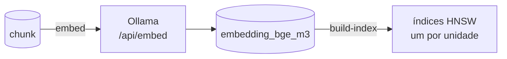

# Módulo de indexação

Este módulo calcula um embedding para cada chunk e constrói o índice vetorial. Cobre o UC-12 (indexar o corpus) e implementa o RF-24 e a parte do RF-25 relativa aos modelos indexados. O índice full-text já existe desde a ingestão: é a coluna `tsv` da tabela `chunk`, com um índice GIN.

## O fluxo



1. **Medir** (`bench`): mede a velocidade com vários tamanhos de lote antes de lançar o corpus inteiro.
2. **Calcular** (`embed`): pede os vetores ao Ollama, em lotes, e guarda-os. Pode ser interrompido e retomado.
3. **Indexar** (`build-index`): constrói o índice HNSW depois de todos os vetores estarem guardados.
4. **Ver o estado** (`status`): mostra, por modelo e por unidade, quantos chunks têm vetor e se há índice.

## Os ficheiros

| Ficheiro | Responsabilidade |
| --- | --- |
| `helixrag/index/ollama_embedder.py` | Pedidos ao Ollama: validação, normalização, novas tentativas |
| `helixrag/db/embeddings.py` | Tabelas por modelo, chunks pendentes, gravação, índice HNSW, estatísticas |
| `helixrag/index/cli.py` | Linha de comandos |

## Decisões de design

### Uma tabela por modelo, com duas colunas a mais

A tabela por modelo já estava decidida (documentação, secção 7.6): um índice HNSW só funciona numa coluna de dimensão fixa. A tabela `embedding_bge_m3` tem `chunk_id`, `embedding` e mais duas colunas que a documentação não previa:

- **`unit`**, repetida da tabela `chunk`. Serve para ter um **índice parcial por unidade** (`WHERE unit = 'full'`).
  - **O problema:** a pesquisa filtra sempre por unidade. Com um único índice para as duas, o HNSW devolve os vizinhos mais próximos de todas as unidades e o filtro só é aplicado depois. Se pedires 10 resultados e 7 dos vizinhos forem chunks `section`, ficas com 3.
  - **A alternativa:** uma tabela por par modelo e unidade. Também resolvia, mas duplicava o código e o registo de modelos.
  - **O custo:** a coluna é uma cópia. Não fica inconsistente porque a unidade de um chunk nunca muda (é parte da chave `pmid, unit, ordinal`).
- **`content_md5`**, o hash do texto que gerou o vetor. Um chunk é considerado pendente se não tem vetor **ou** se o hash já não bate com o texto atual. Sem isto, um vetor calculado para um texto antigo ficava associado ao texto novo, e a pesquisa devolvia resultados errados sem aviso.

### Os ids dos chunks passaram a ser estáveis

A primeira versão do `replace_chunks` apagava e reinseria os chunks a cada `load`. Os ids mudavam e, por causa do `ON DELETE CASCADE`, todos os vetores eram apagados. Um `load` repetido custava horas de embeddings.

Agora os chunks são atualizados no mesmo sítio, identificados por `pmid, unit, ordinal`, e só quando o texto muda. Os chunks a mais são apagados. Repetir o `load` com os mesmos dados não altera nada, e um chunk com texto novo mantém o id e fica pendente pelo `content_md5`.

### Sem corte silencioso de texto

O pedido ao Ollama leva `truncate: false`, `num_ctx: 8192` e `num_batch: 8192`.

- **O problema:** por omissão, o Ollama corta o texto que não cabe e calcula o vetor só do início, sem avisar. Um resumo cortado perde muitas vezes as conclusões, que é onde costuma estar a resposta.
- **O que se mediu** (comando `probe`, Ollama 0.33.3, BGE-M3, chunk mais longo com 10 052 caracteres):

  | Configuração | Resultado |
  | --- | --- |
  | omissão do Ollama | máximo 2 048 tokens (8 094 caracteres) |
  | `num_ctx 8192` | máximo 2 048 tokens: igual, a opção sozinha não chega |
  | `num_ctx 8192`, `num_batch 8192` | cabe inteiro (2 532 tokens) |

  Nos modelos de embedding, o Ollama processa cada texto num único lote interno, por isso o limite real é o `num_batch`. Pedir só um contexto maior, como a primeira versão fazia, não mudava nada.
- **Porque é que `truncate: false` importou:** sem ele, os chunks acima de 2 048 tokens teriam sido cortados sem aviso, e o erro nunca teria aparecido. Foi o erro explícito que levou a esta medição.
- **O custo:** um lote interno maior pode gastar mais memória por pedido. O `bench` mede o efeito na velocidade.

### Normalização dos vetores

Cada vetor é dividido pela sua norma antes de ser guardado. O BGE-M3 já vem normalizado (a experiência E1 mostrou norma 1,0), por isso aqui não muda nada. A divisão protege contra um modelo, na experiência E2, que não venha normalizado. Com vetores de norma 1, o produto interno e o cosseno dão o mesmo valor, e o ranking não depende do operador usado.

### Retoma e transações

Cada lote é confirmado (`commit`) assim que chega. Uma interrupção, por Ctrl+C, por falha do Ollama ou por o Mac adormecer, perde no máximo o lote em curso. A próxima execução procura os chunks pendentes e continua.

Os chunks pendentes são lidos por ordem de id, a partir do último id processado (`c.id > %s`), e não com `OFFSET`. Com `OFFSET 100000`, o PostgreSQL teria de ler e descartar 100 000 linhas a cada lote.

### O índice HNSW só no fim

- **A alternativa:** criar o índice antes e deixá-lo crescer a cada inserção.
- **A escolha:** criá-lo de uma vez no fim. Cada inserção num grafo HNSW obriga a procurar os vizinhos do novo ponto e a religar o grafo, o que é muito mais lento do que construir o grafo inteiro de uma vez. O `embed` avisa se já existir um índice.
- **Parâmetros:** `m = 16` e `ef_construction = 64`, os valores por omissão do pgvector. A experiência E4 compara-os com a pesquisa exata.
- **Memória:** a construção corre com `maintenance_work_mem = 1GB`, para o grafo caber em memória. A construção paralela do pgvector usa memória partilhada, e o Docker só dá 64 MB por omissão. Por isso o `docker-compose.yml` passou a ter `shm_size: 1gb`.

### O tamanho do lote é medido, não adivinhado

O `bench` corre 500 chunks com lotes de 1, 16 e 64 e estima o tempo para o corpus inteiro. A amostra é escolhida por `ORDER BY md5(id)`: mistura artigos curtos e longos e é sempre a mesma, por isso duas medições são comparáveis.

## Como usar

```fish
python -m helixrag.index.cli probe
python -m helixrag.index.cli bench
python -m helixrag.index.cli embed --unit full --batch-size 32
python -m helixrag.index.cli embed --unit section --batch-size 32
python -m helixrag.index.cli build-index
python -m helixrag.index.cli status
```

A unidade `full` vem primeiro porque é a base de comparação (experiência E1) e tem menos chunks (57 938 contra 104 315). Assim, a pesquisa pode começar a ser desenvolvida enquanto os chunks `section` são calculados.

## Testes

| Ficheiro | Cobre |
| --- | --- |
| `test_ollama_embedder.py` | Pedido sem corte, normalização, respostas inválidas, novas tentativas, erros que não se repetem |
| `test_embeddings_repository.py` | Nomes de tabelas seguros, dimensão fixa por modelo, pendentes e retoma, texto alterado, índice parcial, cascata |
| `test_repository.py` | Ids estáveis ao recarregar, unidades independentes |

Os testes da base de dados usam vetores de dimensão 3 escritos à mão: o que se testa é a lógica da base de dados, não o modelo.

## Limitações conhecidas

- **Um pedido de cada vez ao Ollama.** Enquanto o Ollama calcula, a base de dados espera, e vice-versa. Sobrepor as duas coisas (ler o lote seguinte durante o cálculo) pouparia pouco, porque o Ollama domina o tempo. Fica por fazer até as medições mostrarem que vale a pena.
- **Filtros por ano e por MeSH.** O índice parcial resolve o filtro por unidade, mas a pesquisa com filtros por ano (RF-06) ou MeSH (RF-07) volta a ter o problema de filtrar depois. O pgvector 0.8 tem pesquisa iterativa (`hnsw.iterative_scan`), que continua a procurar até ter resultados suficientes. Fica para o módulo de pesquisa.
- **Sem registo das tarefas na base de dados (tabela `job`, RF-26).** Tal como na ingestão, o progresso aparece só no terminal.
