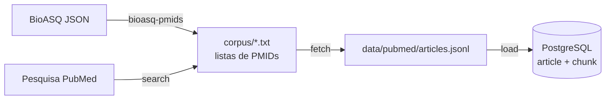

# Módulo de ingestão

Este módulo transforma listas de PMIDs em artigos e chunks guardados no PostgreSQL. Cobre o UC-11 (construir o corpus) e a parte do UC-12 que não envolve embeddings, e implementa os requisitos RF-21, RF-22, RF-23 e RF-25.

## O fluxo



Há três passos separados, cada um com um comando:

1. **Obter listas de PMIDs** (`search` ou `bioasq-pmids`). As listas vão para `corpus/` e entram no Git: são elas que definem o corpus e o tornam reproduzível (RNF-04).
2. **Descarregar** (`fetch`). Os registos vão para `data/pubmed/articles.jsonl`, fora do Git (RNF-10).
3. **Carregar** (`load`). Os artigos e os chunks vão para a base de dados.

## Os ficheiros

| Ficheiro | Responsabilidade |
| --- | --- |
| `helixrag/ingest/models.py` | Os tipos de dados: `Article`, `AbstractSection`, `Chunk`, `BioASQQuestion` |
| `helixrag/ingest/ncbi_client.py` | Pedidos à NCBI com limite de ritmo e novas tentativas |
| `helixrag/ingest/pubmed_xml.py` | XML do PubMed → `Article` |
| `helixrag/ingest/bioasq.py` | JSON do BioASQ → perguntas e PMIDs de ouro |
| `helixrag/ingest/splits.py` | Divisão das perguntas em dev e teste |
| `helixrag/ingest/chunking.py` | `Article` → `Chunk` (unidades `full` e `section`) |
| `helixrag/ingest/pmid_lists.py` | Leitura e escrita das listas em `corpus/` |
| `helixrag/ingest/store.py` | Armazenamento local em JSONL, com retoma |
| `helixrag/ingest/cli.py` | Linha de comandos |
| `helixrag/db/schema.sql` | Tabelas `article` e `chunk` |
| `helixrag/db/repository.py` | Escrita e leitura na base de dados |
| `helixrag/config.py` | Configuração a partir do `.env` |

As dependências só apontam num sentido: `models.py` não depende de nada, e o parser, o chunking e o BioASQ só dependem dos modelos. Por isso podem ser testados sem rede nem base de dados.

## Decisões de design

### Separar o download da base de dados (o ficheiro JSONL)

- **Alternativa:** descarregar e escrever diretamente no PostgreSQL.
- **Porquê separar:** o download é a parte lenta e a única que depende de um serviço externo. Com o JSONL intermédio, um download interrompido retoma onde parou (os PMIDs já guardados são saltados), e a base de dados pode ser recriada ou recarregada com outra unidade de chunking sem pedir nada à NCBI.
- **Porquê JSONL:** cada artigo é uma linha, por isso acrescentar é barato e uma interrupção a meio da escrita só estraga a última linha, que o leitor salta.
- **Custo:** mais um ficheiro em disco, e o mesmo dado existe em dois sítios. Aceitável, porque o JSONL é tratado como cache, nunca como fonte da verdade.

### Cliente NCBI próprio, em vez do Biopython (`Bio.Entrez`)

- **Alternativa:** o módulo `Entrez` do Biopython, que já faz os pedidos.
- **Porquê próprio:** são cerca de cem linhas, sem uma dependência grande, e o comportamento fica explícito e testável: o limite de ritmo, as novas tentativas e os erros. Os testes usam uma sessão, um relógio e um `sleep` falsos, por isso correm em milissegundos e sem rede.
- **Detalhes:**
  - **Ritmo:** 0,34 s entre pedidos sem chave (3 por segundo), 0,11 s com chave (10 por segundo), com uma pequena margem.
  - **Novas tentativas:** erros de rede, 429 e 5xx são temporários e repetem-se com esperas de 1, 2, 4 e 8 s. Os outros 4xx (um pedido mal feito) não se repetem, porque falhariam sempre.
  - **POST em vez de GET:** um lote de 200 PMIDs não cabe com segurança num URL. A NCBI aceita POST nas E-utilities.
  - **Lotes de 200**, devolvidos um a um por um gerador: cada lote é guardado assim que chega.

### Parser com a biblioteca standard

- **Alternativa:** `lxml` (mais rápido) ou `defusedxml` (mais seguro com XML desconhecido).
- **Porquê:** o volume (dezenas de milhares de resumos) não justifica outra dependência, e o XML vem da NCBI. Fica registado que, para XML de origem desconhecida, o `defusedxml` seria a escolha certa.
- **Casos tratados:** marcação dentro do texto (`<i>CFTR</i>`), espaços e quebras de linha, resumos estruturados com rótulos, artigos sem resumo, datas em `MedlineDate` ("2019 Jan-Feb") e registos de livros, que são ignorados.

### Chunking

- **`full`:** um chunk por artigo: o título seguido do resumo inteiro, com os rótulos das secções.
- **`section`:** um chunk por secção, cada um com o título à frente, para não perder o contexto quando é lido sozinho.
- **Resumos sem secções** dão um único chunk também na unidade `section`. Sem isto, esses artigos desapareceriam da experiência E1 e a comparação deixava de ser justa.
- **Artigos sem resumo** são guardados mas não geram chunks (UC-11, fluxo 4a).

### Origem dos artigos: um artigo de ouro nunca passa a distrator

Um PMID pode aparecer na lista de ouro e na de distratores. Se a lista de distratores fosse carregada depois, sem cuidado, o artigo deixaria de contar como ouro, e as métricas da avaliação ficariam erradas sem nenhum aviso. O `upsert_articles` impede isso no próprio SQL.

Acrescentou-se uma terceira origem, `test`, para o corpus de teste usado antes de haver dados do BioASQ.

### O corpus e a divisão das perguntas

O ficheiro usado é o `training14b.json`: 5 729 perguntas e 58 048 PMIDs de ouro únicos.

- **Corpus:** todos os 58 048 artigos de ouro (origem `gold`). Para cada pergunta, os artigos de ouro das outras funcionam como distratores naturais, muitas vezes do mesmo tema, e o corpus fica definido só pelo dataset.
  - **Alternativas:** só o ouro das perguntas avaliadas mais distratores de uma pesquisa MeSH (descartado: os distratores passariam a depender de uma escolha nossa), ou o corpus completo mais distratores extra do PubMed (adiado para uma experiência de escala).
  - **Custo conhecido:** um artigo que responde a uma pergunta mas só foi marcado para outra conta como erro, por isso as métricas ficam um pouco pessimistas.
- **Perguntas:** o ficheiro só tem "treino", por isso a divisão é nossa. O conjunto `dev` (500 perguntas) serve para afinar e o `test` (500 perguntas) só se usa para os números finais. Afinar e medir no mesmo conjunto daria resultados otimistas.
  - **Estratificada:** cada conjunto tem os quatro tipos na proporção do ficheiro (factoid 148, list 99, summary 119, yesno 134). As quotas são repartidas pelo método dos maiores restos, que garante que somam exatamente 500.
  - **Reprodutível sem `random`:** cada pergunta é ordenada pelo SHA-256 de `semente:id`. O resultado não depende da versão do Python nem da ordem das perguntas no ficheiro.
  - **Fora da divisão:** as perguntas sem documentos de ouro e as marcadas pelo BioASQ como duplicado de outra (`duplicate_tmp`). Uma pergunta repetida dos dois lados quebraria a independência do teste.
  - **Rastreável:** os ficheiros `corpus/dev_questions.txt` e `corpus/test_questions.txt` registam no cabeçalho a semente e o SHA-256 do JSON de origem.

### Esquema sem ferramenta de migrações

- **Alternativa:** Alembic, que versiona as alterações ao esquema.
- **Porquê não, para já:** o `schema.sql` é idempotente (`CREATE ... IF NOT EXISTS`) e corre antes de cada carga. Funciona enquanto o esquema só cresce. Quando for preciso alterar uma tabela já existente com dados, passa a justificar-se uma ferramenta de migrações.

## Como usar

```fish
# Corpus de teste, enquanto o BioASQ não chega
python -m helixrag.ingest.cli search "cystic fibrosis[mesh] AND CFTR" --retmax 200 --out corpus/test_pmids.txt
python -m helixrag.ingest.cli fetch corpus/test_pmids.txt
python -m helixrag.ingest.cli load corpus/test_pmids.txt --origin test --unit full
python -m helixrag.ingest.cli stats

# Com o BioASQ
python -m helixrag.ingest.cli bioasq-pmids data/bioasq/training14b.json --out corpus/gold_pmids.txt
python -m helixrag.ingest.cli bioasq-split data/bioasq/training14b.json --dev 500 --test 500
python -m helixrag.ingest.cli fetch corpus/gold_pmids.txt
python -m helixrag.ingest.cli load corpus/gold_pmids.txt --origin gold
```

Para a unidade por secção (experiência E1), basta repetir o `load` com `--unit section`. Os chunks das duas unidades coexistem na tabela.

## Testes

```fish
pip install -r requirements-dev.txt
python -m pytest            # todos
python -m pytest -m "not integration"   # só os que não precisam da base de dados
```

| Ficheiro | Cobre |
| --- | --- |
| `test_pubmed_xml.py` | Marcação interna, espaços, rótulos, datas, artigos sem resumo, registos de livros |
| `test_splits.py` | Tamanhos exatos, conjuntos disjuntos, estratificação, reprodutibilidade, exclusão de duplicados |
| `test_chunking.py` | As duas unidades, resumos sem secções, artigos sem resumo, unidade inválida |
| `test_bioasq.py` | Variantes de URL, repetidos, `ideal_answer` como texto ou lista |
| `test_pmid_lists_and_store.py` | Listas inválidas, retoma do store, linha corrompida |
| `test_ncbi_client.py` | Ritmo com e sem chave, novas tentativas, erros não repetíveis, lotes |
| `test_repository.py` | Esquema idempotente, regra da origem de ouro, substituição de chunks, coluna lexical |

Os testes de integração correm num esquema temporário dentro de uma transação que é desfeita no fim, por isso não tocam nos dados do projeto. Se a base de dados não estiver acessível, são saltados.

## Limitações conhecidas

- **O `esearch` devolve no máximo 10 000 PMIDs por pesquisa.** Para mais distratores, é preciso dividir a pesquisa (por exemplo, por intervalos de anos).
- **Um artigo que perde o resumo entre dois downloads mantém os chunks antigos.** O `replace_chunks` só substitui chunks de artigos que ainda geram chunks. É um caso raro, e uma recarga completa resolve-o.
- **Os ids dos chunks são estáveis.** O `replace_chunks` atualiza cada chunk no mesmo sítio (chave `pmid, unit, ordinal`), em vez de apagar e reinserir. Assim, repetir o `load` não apaga os embeddings. A razão está em `docs/INDEXACAO.md`.
- **O store não deteta artigos alterados na NCBI depois de descarregados.** Para atualizar, apaga-se o `articles.jsonl` e repete-se o `fetch`.
- **Sem registo das tarefas na base de dados (tabela `job`, RF-26).** O progresso aparece só no terminal. A tabela entra com a API, quando houver tarefas em segundo plano.
